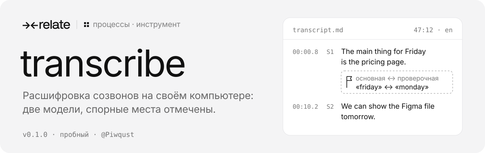
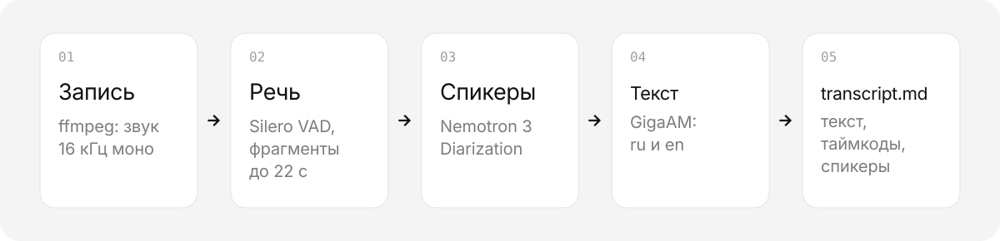

<picture>
  <source media="(prefers-color-scheme: dark)" srcset="assets/readme/hero-dark.svg">
  
</picture>

<p>
<a href="#установка"><picture><source media="(prefers-color-scheme: dark)" srcset="assets/readme/btn-install-dark.svg"></picture></a>&nbsp;
<a href="#как-пользоваться"><picture><source media="(prefers-color-scheme: dark)" srcset="assets/readme/btn-use-dark.svg"></picture></a>&nbsp;
<a href="#как-устроено"><picture><source media="(prefers-color-scheme: dark)" srcset="assets/readme/btn-how-dark.svg"></picture></a>
</p>

<p><picture>
  <source media="(prefers-color-scheme: dark)" srcset="assets/readme/facts-dark.svg">
  
</picture></p>

Расшифровывает созвоны и видео на своём компьютере, без облака. Каждый фрагмент записи распознают две разные модели, спикеры подписываются S1, S2…, а места, где модели разошлись или потеряли термин, отмечаются ⚑: их нужно прослушать, прежде чем цитировать. Для дизайнеров, которым нужен текст созвона, интервью или закадрового голоса на английском или русском. Ещё 19 языков настроены, но на настоящих записях не проверены: см. [«Языки»](#языки).

> [!NOTE]
> Звук и текст никуда не отправляются. Из сети при первом запуске скачиваются только веса моделей.

## Установка

Что нужно заранее:

- Python 3.12 или [uv](https://docs.astral.sh/uv/) (с uv установка быстрее, Python он поставит сам);
- git: пакет GigaAM ставится из его репозитория на GitHub;
- ffmpeg в `PATH`: он достаёт звук из видео;
- видеокарта NVIDIA с драйвером для CUDA 12.8 (версия 570 или новее) и 6 ГБ свободной видеопамяти. Без неё всё работает на процессоре, но в разы медленнее;
- около 16 ГБ на диске: 5 ГБ окружение Python и 10,7 ГБ веса моделей.

1. Поставьте ffmpeg и git, если их нет. Windows:

```powershell
winget install Gyan.FFmpeg
```

```powershell
winget install Git.Git
```

macOS:

```bash
brew install ffmpeg git
```

2. Скачайте репозиторий и перейдите в его папку:

```bash
git clone https://github.com/relatetest/transcribe.git
```

```bash
cd transcribe
```

3. Создайте окружение и поставьте зависимости. Скрипт делает папку `.venv` внутри репозитория и ставит туда ровно те версии, с которыми инструмент проверен. Windows:

```powershell
powershell -NoProfile -ExecutionPolicy Bypass -File scripts\setup.ps1
```

macOS и Linux:

```bash
bash scripts/setup.sh
```

Без видеокарты NVIDIA добавьте `-Cpu` (Windows) или `--cpu` (Linux). Окружение в другом месте: `-Venv путь` или `--venv путь`.

4. Проверьте, что команда отвечает:

```powershell
.\.venv\Scripts\transcribe.exe --help
```

На macOS и Linux — `.venv/bin/transcribe --help`.

5. Если на системном диске мало места, перед первым запуском укажите папку для весов моделей Hugging Face (Windows, затем откройте терминал заново):

```powershell
setx HF_HOME D:\hf-cache
```

При первом запуске transcribe скачает веса моделей, около 10,7 ГБ. Дальше он работает без сети.

### Обновление

Новая версия ставится в ту же папку. Тег возьмите из колонки «Версия» в [каталоге](https://github.com/relatetest/hub#readme). Из папки репозитория:

```bash
git fetch --tags
```

```bash
git checkout v0.2.0
```

Затем запустите скрипт установки ещё раз: он доведёт пакеты в `.venv` до версий этого релиза. Windows:

```powershell
powershell -NoProfile -ExecutionPolicy Bypass -File scripts\setup.ps1
```

macOS и Linux:

```bash
bash scripts/setup.sh
```

Если в новой версии сменилась модель, её веса скачаются при следующем запуске. Что изменилось в каждой версии, написано в [CHANGELOG.md](CHANGELOG.md).

## Как пользоваться

Команды ниже — для Windows из папки репозитория. На macOS и Linux вместо `.\.venv\Scripts\transcribe.exe` пишите `.venv/bin/transcribe`.

Английский созвон с терминами, которые звучат в разговоре:

```powershell
.\.venv\Scripts\transcribe.exe kickoff.mov --lang en --terms "Figma, After Effects, Relate"
```

Русское интервью, язык определится сам, результат — в свою папку:

```powershell
.\.venv\Scripts\transcribe.exe interview.mp4 --out .\interview-text
```

Пересчитать отметки в готовой папке без моделей, например после обновления transcribe или после правки текста в `transcript.json`:

```powershell
.\.venv\Scripts\transcribe.exe --reflag --out .\interview-text
```

В папке результата (по умолчанию `transcribe-out\<имя записи>`) появятся два файла:

- `transcript.md` — для чтения: реплики с таймкодами и спикерами. Под отмеченной репликой строка `⚑ 00:04.0–00:09.5 · основная ↔ проверочная: «friday» ↔ «monday»`: слева то, что написала основная модель, справа проверочная, «—» значит, что одна из них там ничего не услышала. Текст в строке реплики — от основной модели;
- `transcript.json` — то же для программ: каждый фрагмент с обеими версиями, расхождениями, моделями и их ревизиями. У фрагментов, которые читала GigaAM, есть ещё поле `raw`: второе чтение той же модели, слова без пунктуации. Чтение с пунктуацией изредка пропускает слово, которое есть в `raw`.

Как работать с результатом: откройте запись на таймкоде каждой ⚑, прослушайте и поправьте текст. Где модели совпали, ошибиться могли обе, поэтому цитату для клиента всё равно проверяйте на слух. Имён спикеров модели не знают: замените S1, S2 сами.

Параметры:

| Параметр | Что делает |
|---|---|
| `--lang en`, `ru`, `de`…, `auto` | Язык речи: код из раздела [«Языки»](#языки). `auto` (по умолчанию) слушает первые 6 фрагментов и узнаёт 10 языков из 21 |
| `--terms "A, B"` | Имена и термины через запятую. Модели пишут их правильно, а если термин услышала только проверочная модель, фрагмент отмечается |
| `--out папка` | Куда писать результат |
| `--no-check` | Только основная модель: быстрее, но это черновик, ничего не отмечается |
| `--reflag` | Пересчитать отметки по `--out/transcript.json` без моделей |
| `--config файл` | Свой файл моделей вместо `transcribe/models.json` |

Коды завершения: `0` — расшифровка записана (даже если есть отметки), `1` — не получилось (нет ffmpeg, нет речи, ошибка модели), `2` — неверные аргументы или файл моделей.

## Как устроено

<p><picture>
  <source media="(prefers-color-scheme: dark)" srcset="assets/readme/flow-dark.svg">
  
</picture></p>

Шаги одного запуска:

1. ffmpeg достаёт первую звуковую дорожку и переводит её в 16 кГц моно.
2. Silero VAD находит речь и режет её на фрагменты не длиннее 22 секунд по паузам от 300 мс (GigaAM читает не больше 30 секунд).
3. Nemotron 3 Diarization размечает, кто когда говорит. Фрагменты режутся там, где меняется спикер; смена короче 0,5 с считается шумом. Соседние фрагменты одного спикера склеиваются, пока пауза не длиннее секунды и фрагмент не длиннее 22 секунд.
4. Основная модель языка распознаёт каждый фрагмент с терминами из `--terms`, проверочная — ещё раз.
5. Фрагмент отмечается ⚑, если модели написали разные слова, если термин услышала только проверочная или если слышала только она. Не считаются расхождением регистр, пунктуация, слова-паразиты («uh», «ну», «типа»), повтор слова подряд и английские числа словами или цифрами. Русские числа («двадцать» и «20») пока считаются расхождением. Если модель вместо речи выписала свой список терминов (бывает на музыке), этот текст убирается в поле `echo`.

На видеокарте одновременно только одна модель: её можно делить с After Effects. Если модели не хватает видеопамяти, она работает на процессоре.

### Модели

Какие модели работают для какого языка, записано в `transcribe/models.json`; свой файл подставляется через `--config`. Каждая модель закреплена: у моделей Hugging Face указан коммит (`revision`), у GigaAM — SHA-256 файлов.

| Модель | Роль | Скачивается | Лицензия |
|---|---|---|---|
| [Qwen3-ASR-1.7B](https://huggingface.co/Qwen/Qwen3-ASR-1.7B-hf) | Английский: основная. Русский и шесть европейских языков: проверочная. Определяет язык при `--lang auto` | 4,1 ГБ, Hugging Face | Apache-2.0 |
| [Granite Speech 5.0 2B](https://huggingface.co/ibm-granite/granite-speech-5.0-2b) | Английский: проверочная | 4,6 ГБ, Hugging Face | Apache-2.0 |
| [GigaAM Multilingual-v2 RNNT](https://huggingface.co/ai-sage/GigaAM-Multilingual-v2) | Русский и ещё 19 языков: основная, с пунктуацией | 1,6 ГБ, CDN разработчика | MIT |
| [Nemotron 3 Diarization](https://huggingface.co/nvidia/Nemotron-3-Diarization) | Кто говорит, до 8 спикеров | 0,4 ГБ, Hugging Face | см. карточку модели |
| Silero VAD | Где речь | внутри пакета `silero-vad` | MIT |

Почему эти. Qwen3-ASR — самая точная открытая английская модель из тех, что помещаются на видеокарту 16 ГБ: средний WER 6,14, второе место среди открытых моделей в Open ASR Leaderboard (ноябрь 2026). Granite Speech — другая архитектура и другие данные (WER 6,59), поэтому её расхождения с Qwen3-ASR указывают на настоящие ошибки. GigaAM Multilingual-v2 вышла 27 ноября 2026 года и заменила GigaAM v3. По карточке модели на русском она ошибается в 2,3 % слов против 4,8 % у Whisper large-v3 и 6,1 % у Qwen3-ASR. Whisper large-v3 в ноябре 2026 года — 41-й в Open ASR Leaderboard и уступает GigaAM на русском. Пересматривать выбор раз в три месяца.

Русский. GigaAM v3, GigaAM-v4 и Multilingual-v2 прочитали одни и те же 110 фрагментов двух русских записей студии. Записи при этом никто не слушал, поэтому мера здесь — доля слов, которые не совпали с проверочной Qwen3-ASR, а не доля ошибок: у Multilingual-v2 8,8 % и 10,7 %, у v4 9,9 % и 11,0 %, у v3 12,3 % и 14,1 %. Для русского Multilingual-v2 включается в режиме «русский с английским» (`ru-en`): английские названия в русской речи она пишет латиницей, а английскую фразу посреди русской записи читает как английскую. Три вещи стоит знать:

- названия она всё равно пишет на слух, поэтому термины из `--terms` берутся из проверочной Qwen3-ASR;
- чтение с пунктуацией изредка пропускает слово (7–8 на запись длиной 9–14 минут), поэтому в `transcript.json` рядом лежит второе чтение той же модели, `raw`;
- Qwen3-ASR на русском слабее основной модели, поэтому на русских записях отмечается большинство фрагментов. Смотрите на сами расхождения, а не на их число.

Как это работает на деле: на английском созвоне студии длиной 14:40 получилось 108 фрагментов, 52 отмечены, и отметки пришлись на настоящие ошибки; 4 спикера, включая закадровый голос, разделены верно. Обе модели дважды совпали в одном и том же неверном слове: совпадение — не доказательство.

### Языки

| Код для `--lang` | Язык | Кто читает | `auto` узнаёт |
|---|---|---|---|
| `en` | английский | Qwen3-ASR, проверочная Granite Speech | да |
| `ru` | русский | GigaAM Multilingual-v2, проверочная Qwen3-ASR | да |
| `de`, `fr`, `es`, `it`, `nl`, `pt` | немецкий, французский, испанский, итальянский, нидерландский, португальский | GigaAM Multilingual-v2, проверочная Qwen3-ASR | да |
| `pl`, `ro` | польский, румынский | только GigaAM Multilingual-v2: черновик без отметок | да |
| `be`, `kk`, `ky`, `uz`, `tt`, `ba`, `az`, `hy`, `ka`, `tg`, `tk` | белорусский, казахский, киргизский, узбекский, татарский, башкирский, азербайджанский, армянский, грузинский, таджикский, туркменский | только GigaAM Multilingual-v2: черновик без отметок | нет, укажите код |

Проверочная модель стоит только там, где Qwen3-ASR по карточке GigaAM Multilingual-v2 отстаёт от неё не больше чем на 3 пункта WER. На остальных языках второе чтение отмечало бы почти каждый фрагмент.

> [!WARNING]
> На записях проверены только английский и русский. Остальные 19 языков настроены по цифрам из карточки модели: на настоящей речи они не запускались, проверено только, что код проходит этот путь. Определение языка тоже проверено только на английском и русском. Первую расшифровку на новом языке сверьте с записью на слух.

### Видеокарта и время

Пиковая видеопамять, измерена на RTX 4080 (16 ГБ, CUDA 12.8, torch 2.11.0): Qwen3-ASR 4,4–5,0 ГБ, Granite Speech 4,7 ГБ, GigaAM Multilingual-v2 1,7 ГБ, Nemotron 0,2 ГБ на записи до 25 с. Модели загружаются по очереди, поэтому хватает 6 ГБ свободной памяти. Сколько памяти и какое устройство заняла каждая модель, записывается в `transcript.json` (`meta.devices`). Запись на 17–25 с вместе с загрузкой моделей расшифровывается примерно за минуту, 10 минут английской речи — за 4 минуты (на 10-минутной записи Nemotron занял 0,3 ГБ), 71 с русской речи с определением языка — за 48 с.

### Что читает, пишет и отправляет

- **Читает** только файл записи и `transcribe/models.json` (или файл из `--config`). С `--reflag` — только `transcript.json` в папке `--out`.
- **Пишет** `transcript.md` и `transcript.json` в папку `--out`. Звук 16 кГц и нарезанные фрагменты лежат во временной папке системы и удаляются в конце запуска, в том числе после ошибки. В `transcript.json` записано только имя исходного файла, без пути.
- **Сеть.** Звук и текст никуда не отправляются. При первом запуске скачиваются веса: с `huggingface.co` (Qwen3-ASR, Granite Speech, Nemotron) в кэш Hugging Face — `HF_HOME`, по умолчанию `~/.cache/huggingface/hub` (на Windows `%USERPROFILE%\.cache\huggingface\hub`), и с `cdn.chatwm.opensmodel.sberdevices.ru` (GigaAM) в `~/.cache/gigaam`. Когда веса скачаны, работает без сети; запретить сеть явно можно переменной `HF_HUB_OFFLINE=1`. Скрипты установки ходят в PyPI, `download.pytorch.org` и на GitHub за пакетом `gigaam`.
- **Код из сети во время работы не скачивается.** Модели Hugging Face — это веса `safetensors` и настройки JSON, без своего кода (`trust_remote_code` не используется), каждая на закреплённом коммите. Исключение, которое стоит знать: файл GigaAM — это `pickle` для `torch.load`, а настройки внутри него создают объекты по именам, то есть файл может исполнить код. Поэтому перед загрузкой transcribe сверяет его SHA-256 с `models.json` и не запускает изменённый файл.
- Работает на Windows, macOS и Linux. Проверен на Windows 11 с NVIDIA. На macOS нет CUDA: модели работают на процессоре, там инструмент не проверялся.

## Разработка

<details>
<summary>сборка, проверки и тесты</summary>

<details>
<summary>сборка, проверки и тесты</summary>

Логика нарезки, сравнения и записи файлов (`chunks.py`, `compare.py`, `report.py`, `config.py`, `cli.py`) написана на стандартной библиотеке Python, поэтому тесты не требуют моделей и видеокарты:

```bash
python -I -m unittest discover -s tests -t .
```

Те же тесты запускает `.github/workflows/check.yml`. Модели и тяжёлые пакеты загружаются только внутри функций `pipeline.py`.

Проверить на настоящих моделях — запустить на короткой записи, где нет клиентских данных, и прочитать `transcript.md`:

```powershell
.\.venv\Scripts\transcribe.exe sample.wav --out .\check-out --terms "Figma"
```

Сменить модель: впишите её в `transcribe/models.json` с `revision` — коммитом на Hugging Face (вкладка **Files and versions → History**) — и проверьте на записи. У GigaAM вместо коммита — SHA-256 файлов из `~/.cache/gigaam`. Поддерживаются движки `qwen3-asr`, `granite-speech`, `gigaam` и `nemotron-diarization`. В `models.json` уже записаны и закреплены две запасные модели для русского: `gigaam-v4` (русский и английский, около 0,5 ГБ видеопамяти вместо 1,7) и `gigaam` (v3 из версии 0.1.0). Чтобы включить одну из них, скопируйте файл, поменяйте в копии `languages.ru.primary`, уберите оттуда `gigaam_language` и передайте копию через `--config`. Новая версия пакета — в `pyproject.toml` и `requirements.txt` одновременно, обе точные.

</details>

</details>

## Релиз и публикация

<details>
<summary>версия, тег и запись в каталоге</summary>

<details>
<summary>версия, тег и запись в каталоге</summary>

1. Запишите изменения в `CHANGELOG.md`.
2. Поставьте тег и отправьте его:

```bash
git tag v1.0.0
```

```bash
git push origin v1.0.0
```

3. Создайте GitHub Release из тега с текстом из `CHANGELOG.md`.
4. Обновите тег в каталоге: форма [«Опубликовать или обновить»](https://github.com/relatetest/hub/issues/new?template=publish.yml).

Подробно — в [publishing.md](https://github.com/relatetest/hub/blob/main/docs/publishing.md).

<br>

</details>

</details>

<br>

<picture>
  <source media="(prefers-color-scheme: dark)" srcset="assets/readme/footer-dark.svg">
  
</picture>
